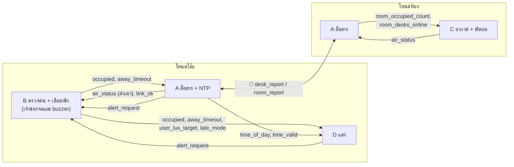

# A1 ตารางข้อมูลกลาง (Interface Contract)

| รายการ | ค่า |
|---|---|
| เวอร์ชัน | **v1.0** |
| วันที่ | 2026-10-14 |
| เจ้าของ | A |
| ตรวจเทียบ | D1 Requirement v1 (`01_requirements/D1_requirements.md`), B2, C2, D3 |
| สถานะ | ✅ ยืนยันแล้ว รอ D ติ๊กรับรองในเช็คก่อนส่งของ D1 |

> ตารางนี้คือ "สัญญา" ระหว่างโมดูล บอกว่าแต่ละโมดูลส่งข้อมูลอะไรออก และรับอะไรเข้า
> แต่ละคนออกแบบข้างในโมดูลของตัวเองได้อิสระ แต่ **ห้ามเปลี่ยนชื่อ ชนิด หรือความหมายของข้อมูลในตารางนี้เอง**
> ถ้าต้องการเปลี่ยน ให้เปิด Issue แบบ "ขอเปลี่ยนตารางข้อมูลกลาง" (ดูข้อ 9)
> เนื้อหาข้อ 1–8 ใช้ลงเล่มหัวข้อ 3 (Interconnection) ได้ทันที

---

## 1. ข้อตกลงทั่วไป

- **ชื่อข้อมูล** ใช้ตัวพิมพ์เล็กคั่นด้วยขีดล่าง (`snake_case`) และใช้ชื่อเดียวกันทั้งใน logic, โค้ด และเอกสาร
- **หน่วย** CO₂ = ppm, อุณหภูมิ = °C, ความชื้น = %RH, ความสว่าง = lux, เวลาในโปรแกรม = ms, เวลานั่ง = นาที, เวลาจริง = เวลาประเทศไทย (UTC+7)
- **ชนิดข้อมูล** ระบุเป็นชนิดของภาษา C ที่ใช้ในโค้ด (ESP32, Arduino framework) เช่น `bool`, `uint8_t`, `uint16_t`
- **เจ้าของ (ใครสร้าง)** ทุกข้อมูลมีผู้สร้างคนเดียว คนอื่นอ่านได้อย่างเดียว ถ้าต้องการให้ค่าเปลี่ยน ให้ส่งคำขอไปที่เจ้าของ
- **ขอบเขต**
  - 🏠 **ภายในโหนด** ส่งต่อกันในโปรแกรมเดียวกัน ผ่านตัวแปรที่ป้องกันด้วย mutex หรือผ่าน queue ของ FreeRTOS (บท 16 หน้า 9)
  - 📡 **ข้าม Wi-Fi** ส่งระหว่างโหนดโต๊ะกับโหนดห้อง รายละเอียดโปรโตคอลอยู่ใน `04_logic/A3_communication.md`
- **ข้อมูลเก่า (stale)** ข้อมูลที่ส่งข้าม Wi-Fi ถ้าไม่ได้รับเกิน **3 รอบการส่ง** ให้ถือว่าใช้ไม่ได้ (รอบปกติ 5 วินาที จึงเท่ากับ 15 วินาที)
  - เหตุผล: ยอมให้ข้อความหายติดกันได้ 2 ครั้งก่อนตัดสินว่าการเชื่อมต่อมีปัญหา ไม่เตือนผิดจากสัญญาณ Wi-Fi สะดุดชั่วคราว และสอดคล้องกับ NFR-07 ที่ใช้เกณฑ์ "3 รอบติดกัน" กับเซนเซอร์

---

## 2. ภาพรวมการไหลของข้อมูล

---

## 3. ข้อมูลในโหนดโต๊ะ

| ข้อมูล | ความหมาย | ชนิด / ช่วงค่า | ใครสร้าง | ใครใช้ | อัปเดต | ขอบเขต | ถ้าไม่มีค่าหรือค่าเสีย |
|---|---|---|---|---|---|---|---|
| `occupied` | ตอนนี้มีคนนั่งไหม | `bool` | B | D (เปิดไฟ), A (ส่งให้โหนดห้อง) | เมื่อเปลี่ยน (ตรวจทุก 100 ms, ต้องเห็นผลเดิม 1 วินาที) | 🏠 + 📡 | เซนเซอร์คนเสีย: `true` เพื่อไม่ปิดไฟใส่คน (B2) |
| `sit_minutes` | นั่งต่อเนื่องมากี่นาทีแล้ว | `uint16_t` นาที | B | B (จอ, ตัดสินใจเตือน) | ทุก 1 วินาที | 🏠 | — |
| `away_timeout` | ไม่มีคนต่อเนื่องครบ 5 นาที (D1 ค่าเกณฑ์) | `bool` | B | D (หรี่แล้วปิดไฟ, FR-08), A (ลดรอบส่งข้อมูล, NFR-08) | เมื่อเปลี่ยน | 🏠 | `false` |
| `user_lux_target` 🆕 | ความสว่างเป้าหมายที่ผู้ใช้ตั้ง (FR-07) | `uint16_t` lux, 500–1,000, ค่าเริ่มต้น 500 | B (จากปุ่มและจอ) | D (เป้าหมายของวงป้อนกลับ) | เมื่อเปลี่ยน | 🏠 | 500 · D ต้องจำกัดค่าให้อยู่ในช่วงเสมอ (NFR-15) |
| `late_mode` 🆕 | โหมดทำงานดึก ใช้สีแสงกลางวันต่อหลัง 19:00 (FR-10) | `bool`, ค่าเริ่มต้น `false` | B (จากปุ่มและจอ) | D (เลือกสีแสง) | เมื่อเปลี่ยน | 🏠 | `false` |
| `time_of_day` | เวลาจริงตอนนี้ (UTC+7) | `struct { uint8_t hour; uint8_t minute; }` | A (NTP + นาฬิกาในตัว) | D (เลือกสีแสง) | ทุก 1 นาที | 🏠 | ดู `time_valid` |
| `time_valid` | เวลาเชื่อถือได้ไหม (ซิงก์ NTP สำเร็จอย่างน้อย 1 ครั้งหลังเปิดเครื่อง) | `bool` | A | D | เมื่อเปลี่ยน | 🏠 | `false` จนกว่าจะซิงก์สำเร็จครั้งแรก D ใช้สีกลาง 50:50 (D1, FR-09) · เมื่อซิงก์แล้ว Wi-Fi หลุดภายหลังยังเป็น `true` เพราะนับเวลาต่อเองได้ (FR-20) |
| `lux_now` | ความสว่างบนโต๊ะตอนนี้ | `uint16_t` lux | D | D | ทุก 200 ms | 🏠 | D3 (เสีย 3 รอบติดกัน → สถานะ SENSOR_FAULT) |
| `air_status` (สำเนา) | ข้อมูลอากาศที่รับจากโหนดห้อง (โครงสร้างดูข้อ 5) | `air_status_t` | A (เขียนสำเนาจาก `room_report`) | B (แสดงบนจอ, ตัดสินการเตือนเรื่องอากาศ) | ทุก 5 วินาที | 📡 → 🏠 | `age_s > 15` → B แสดง "ไม่มีข้อมูลอากาศ" |
| `link_ok` | ติดต่อโหนดห้องได้ไหม | `bool` | A | B (ไอคอนลิงก์บนจอ) | ทุก 5 วินาที และเมื่อเปลี่ยน | 🏠 | `false` |
| `alert_request` | คำขอให้จอหรือ buzzer เตือน (โครงสร้างดูข้อ 6) | `alert_request_t` ผ่าน queue | B, D, A (ภายในโหนดโต๊ะเท่านั้น) | B (เจ้าของจอและ buzzer) | เมื่อมีเหตุ | 🏠 | — |
| `i2c_lock` | ตัวล็อกสาย I²C ของโหนดโต๊ะ | FreeRTOS mutex | A (สร้างและกำหนดกติกา) | B (OLED), D (BH1750) | ทุกครั้งที่ใช้ I²C | 🏠 | ดูข้อ 7 |

### กติกาของค่าที่ผู้ใช้ปรับ (`user_lux_target`, `late_mode`)

- B เป็นเจ้าของคนเดียว รับคำสั่งจากปุ่มและแสดงผลบนจอ
- เมื่อ `away_timeout` เปลี่ยนเป็น `true` **B เป็นคนคืนค่าทั้งสองเป็นค่าเริ่มต้น** (500 lux, `false`) ตาม FR-11
- D อ่านค่าอย่างเดียว ไม่เขียนกลับ เพื่อให้ข้อมูลมีเจ้าของคนเดียว (ตอบคำถามท้าย D3 ข้อ "เรื่องที่ A ต้องรู้")

## 4. ข้อมูลในโหนดห้อง

| ข้อมูล | ความหมาย | ชนิด / ช่วงค่า | ใครสร้าง | ใครใช้ | อัปเดต | ขอบเขต | ถ้าไม่มีค่าหรือค่าเสีย |
|---|---|---|---|---|---|---|---|
| `air_status` | ค่าอากาศในห้อง + ระดับเตือน (โครงสร้างดูข้อ 5) | `air_status_t` | C | A (ส่งให้ทุกโต๊ะ), C (คุมพัดลมและไฟสถานะ) | ทุก 5 วินาที | 🏠 + 📡 | C ตั้ง `sensor_ok = false` (C2 สถานะ SENSOR_FAULT) |
| `room_occupied_count` | จำนวนโต๊ะที่ออนไลน์และมีคนนั่ง | `uint8_t` | A (นับจาก `desk_report` ของทุกโต๊ะ) | C (ลดหรือปิดพัดลมเมื่อห้องว่าง, FR-15) | ทุก 5 วินาที | 🏠 | นับเฉพาะโต๊ะที่ออนไลน์ |
| `room_desks_online` | จำนวนโต๊ะที่ติดต่อได้ | `uint8_t` | A | C | ทุก 5 วินาที | 🏠 | 0 แปลว่า **"ไม่รู้"** ไม่ใช่ "ห้องว่าง" |
| `i2c_lock` | ตัวล็อกสาย I²C ของโหนดห้อง | FreeRTOS mutex | A | C (SCD41) | ทุกครั้งที่ใช้ I²C | 🏠 | ดูข้อ 7 |

> **กติกาห้องว่างสำหรับ C (FR-15 + NFR-06):** ถือว่าห้องว่างเมื่อ `room_desks_online > 0` **และ** `room_occupied_count == 0` เท่านั้น
> ถ้า `room_desks_online == 0` (Wi-Fi ล่มหรือทุกโต๊ะติดต่อไม่ได้) ให้คุมพัดลมตาม CO₂ ต่อไปเหมือนมีคน เพราะไม่มีข้อมูลว่าห้องว่างจริง การปิดพัดลมในกรณีนี้อาจปล่อยให้ CO₂ สะสมขณะยังมีคนอยู่

---

## 5. โครงสร้าง `air_status_t`

| ฟิลด์ | ความหมาย | ชนิด / หน่วย | ใครกำหนดค่า |
|---|---|---|---|
| `co2_ppm` | ความเข้มข้น CO₂ | `uint16_t` ppm | C |
| `temp_c_x10` | อุณหภูมิ × 10 (เช่น 235 = 23.5°C) | `int16_t` | C |
| `rh_pct` | ความชื้นสัมพัทธ์ (แสดงอย่างเดียว ไม่เตือน, FR-18) | `uint8_t` % | C |
| `co2_level` | ระดับคุณภาพอากาศ: 0 ดี / 1 เริ่มแย่ / 2 แย่ | `uint8_t` | C (เกณฑ์และ hysteresis ตาม C2 และ D1 FR-13) |
| `temp_flag` | อุณหภูมิ: 0 อยู่ในช่วง / 1 ต่ำกว่า 20°C / 2 สูงกว่า 26°C | `uint8_t` | C (เกณฑ์ D1 FR-17) |
| `sensor_ok` | SCD41 อ่านค่าได้ปกติไหม | `bool` | C (`false` เมื่อเสีย 3 รอบติดกัน, NFR-07) |
| `fan_pct` 🆕 | ความแรงพัดลมตอนนี้ (แสดงบนจอโต๊ะ ให้ผู้ใช้รู้ว่าระบบกำลังระบายอากาศ) | `uint8_t` 0–100 % | C |
| `age_s` | ข้อมูลนี้อายุกี่วินาที นับจากที่โหนดโต๊ะได้รับ | `uint16_t` วินาที | A (คำนวณฝั่งโต๊ะ ไม่ส่งข้าม Wi-Fi) |

- อุณหภูมิส่งเป็นจำนวนเต็ม × 10 เพราะข้อความสั้นกว่า และไม่มีปัญหาเรื่องรูปแบบทศนิยมระหว่างโหนด
- ข้อมูลอากาศทั้งหมดเดินทางไปโต๊ะผ่าน `air_status` อย่างเดียว **โหนดห้องไม่ส่ง `alert_request` ข้าม Wi-Fi** (ตัดสิน Q2) เหตุผล:
  1. โหนดห้องไม่มีจอและ buzzer จึงไม่มีผู้รับ `alert_request` ในโหนดห้อง
  2. ถ้าโต๊ะเพิ่งต่อเข้ามาหรือข้อความเตือนหาย โต๊ะยังรู้สถานะปัจจุบันจาก `air_status` ที่ส่งซ้ำทุก 5 วินาที ส่วนข้อความเตือนแบบครั้งเดียวจะหายไปเลย
  3. logic การเตือนบนจอโต๊ะอยู่ที่ B คนเดียว ลำดับความสำคัญจึงตัดสินที่เดียว

## 6. โครงสร้าง `alert_request_t`

| ฟิลด์ | ความหมาย | ค่าที่เป็นไปได้ |
|---|---|---|
| `source` | โมดูลที่ขอ | `SRC_PRESENCE` (B), `SRC_AIR` (B แปลงจาก `air_status`), `SRC_LIGHT` (D), `SRC_COMM` (A) |
| `type` | เรื่องที่เตือน | `ALERT_EYE_BREAK`, `ALERT_STAND_BREAK`, `ALERT_CO2_HIGH`, `ALERT_TEMP`, `ALERT_SENSOR_FAULT`, `ALERT_LINK_LOST` |
| `priority` | ความสำคัญ | 0 แจ้งให้ทราบ (จออย่างเดียว) / 1 เตือน (จอ + buzzer สั้น) / 2 ด่วน (จอ + buzzer ซ้ำ) |
| `action` | เปิดหรือปิดการเตือน | `ALERT_SHOW`, `ALERT_CLEAR` |

- ส่งผ่าน FreeRTOS queue ไปยังงานย่อย `display_alert_task` ของ B (queue ป้องกันการแย่งในตัว ไม่ต้องใช้ mutex)
- B เป็นคนตัดสินว่าจะแสดงอะไรเมื่อมีหลายเตือนพร้อมกัน (ลำดับใน B2 ข้อ 7: priority 2 → 1 → 0, เท่ากันใครมาก่อนแสดงก่อน)
- **การเตือนเรื่องอากาศ:** B อ่าน `air_status` แล้วตัดสินเอง (`co2_level == 2` → `ALERT_CO2_HIGH`, `temp_flag != 0` → `ALERT_TEMP`, `sensor_ok == false` → `ALERT_SENSOR_FAULT` จาก `SRC_AIR`)
- **A ส่ง** `ALERT_LINK_LOST` priority 0 (จออย่างเดียว ไม่มีเสียง เพราะผู้ใช้แก้เองไม่ได้ และระบบยังทำงานต่อได้ตาม NFR-06)
- NFR-14 (เตือน 2 ช่องทาง): priority 1 และ 2 ใช้จอ + เสียงเสมอ

## 7. กติกาการใช้ `i2c_lock`

1. ขอล็อกก่อนคุยกับอุปกรณ์ I²C ทุกครั้ง และปล่อยทันทีเมื่อจบ 1 รายการ (transaction)
2. รอล็อกได้ไม่เกิน **50 ms** ถ้าไม่ได้ ให้ข้ามรอบนี้และนับเป็นความผิดพลาด ห้ามรอไม่มีกำหนด
   - เหตุผล: 50 ms ยาวกว่า transaction ที่ยาวที่สุด (วาด OLED ทั้งจอ ≈ 8 ms ตาม B3) หลายเท่า แต่สั้นกว่ารอบของงานที่ใช้ I²C ถี่ที่สุด (คุมแสง 200 ms) จึงไม่ทำให้งานนั้นพลาด deadline
3. ห้ามถือล็อกขณะสั่งหน่วงเวลา (`vTaskDelay`) หรือขณะรอข้อมูลจาก Wi-Fi
4. ใช้ mutex ไม่ใช่ binary semaphore เพราะ mutex ของ FreeRTOS มี priority inheritance ลดปัญหางานความสำคัญต่ำถือล็อกค้างจนงานสำคัญรอ (priority inversion) [A1-1]

## 8. ข้อความที่ส่งข้าม Wi-Fi (สรุป รายละเอียดใน A3)

| ข้อความ | ทิศทาง | ข้อมูลข้างใน | ความถี่ |
|---|---|---|---|
| `desk_report` | โต๊ะ → ห้อง | `desk_id`, `occupied`, `report_interval_s`, `seq` | ทุก 5 วินาที, ทุก 15 วินาทีเมื่อ `away_timeout` เป็นจริง และส่งทันทีเมื่อ `occupied` เปลี่ยน |
| `room_report` | ห้อง → ทุกโต๊ะ | `air_status_t` (ยกเว้น `age_s`), `seq` | ทุก 5 วินาที หลังอ่าน SCD41 แต่ละรอบ |

| ฟิลด์ | ชนิด | ความหมาย |
|---|---|---|
| `desk_id` | `uint8_t` 1–254 | เลขโต๊ะ ตั้งตอนติดตั้ง ใช้นับ `room_occupied_count` และเพิ่มโต๊ะได้โดยไม่แก้โปรแกรมโหนดห้อง (NFR-13) |
| `report_interval_s` | `uint8_t` | รอบการส่งของโต๊ะนั้น โหนดห้องใช้ตัดสินว่าโต๊ะหลุด (เกิน 3 × รอบ) |
| `seq` | `uint16_t` | เลขลำดับข้อความ ใช้ตรวจว่าข้อความหายหรือซ้ำ |

- ข้อมูลรายโต๊ะ (`occupied` ของแต่ละโต๊ะ) ใช้ภายในห้องเท่านั้น ถ้าส่งออกนอกระบบในอนาคตจะส่งเฉพาะค่ารวมของห้อง (NFR-16)

---

## 9. วิธีขอเปลี่ยนตารางนี้

1. เปิด Issue โดยใช้แบบฟอร์ม "ขอเปลี่ยนตารางข้อมูลกลาง" บอกว่าจะเปลี่ยนอะไร และเพราะอะไร
2. A ตัดสินร่วมกับ D
3. A แก้ไฟล์นี้ ขึ้นเวอร์ชันใหม่ บันทึกในข้อ 11 และแจ้งในกลุ่มแชท

## 10. ผลการตัดสินเรื่องที่ค้างจาก v0.1

| # | เรื่อง | ผล | ที่มา |
|---|---|---|---|
| Q1 | เจ้าของตัวนับ "ไม่มีคนครบ 5 นาที" | ✅ B เป็นเจ้าของ `away_timeout` | B2 และ D3 ออกแบบตามนี้แล้ว |
| Q2 | ใครแปลงข้อมูลอากาศเป็นการเตือนบนโต๊ะ | ✅ B อ่าน `air_status` แล้วตัดสินเอง โหนดห้องไม่ส่ง `alert_request` | ข้อ 5 และ 6 |
| Q3 | ลำดับความสำคัญเมื่อมีหลายเตือน | ✅ ตาม B2 ข้อ 7 | B2 |
| Q4 | ช่วงอุณหภูมิของ `temp_flag` | ✅ ต่ำกว่า 20°C หรือสูงกว่า 26°C | D1 FR-17 |
| Q5 | `occupied` เมื่อเซนเซอร์คนเสีย | ✅ `true` | B2 |
| Q6 🆕 | ใครคืนค่าที่ผู้ใช้ปรับเมื่อไม่มีคน (FR-11) | ✅ B คืนค่าเมื่อ `away_timeout` เป็นจริง D อ่านอย่างเดียว | ข้อ 3 |
| Q7 🆕 | ห้องว่างหรือไม่รู้ เมื่อ Wi-Fi ล่ม | ✅ ใช้ `room_desks_online` แยก "ไม่รู้" ออกจาก "ว่าง" | ข้อ 4 |

## 11. ประวัติการแก้ไข

| เวอร์ชัน | วันที่ | แก้อะไร |
|---|---|---|
| v0.1 | 2026-10-13 | ร่างแรกจากไฟล์ภาพรวมข้อ 5 เพิ่ม `away_timeout`, `time_valid`, `link_ok`, `room_desks_online`, `desk_id`, กำหนดโครงสร้าง `air_status_t`, `alert_request_t` และกติกา `i2c_lock` |
| v1.0 | 2026-10-14 | ยืนยันตาม D1 v1: เพิ่ม `user_lux_target` และ `late_mode` (คำขอจาก D1), เพิ่ม `fan_pct` และ `report_interval_s`, ปิด Q1–Q7, ยกเลิก `alert_request` ข้าม Wi-Fi, เพิ่มแผนภาพการไหลของข้อมูล |

## อ้างอิง

[A1-1] Real Time Engineers Ltd., "Mutexes," *FreeRTOS Documentation*. [Online]. Available: https://www.freertos.org/Real-time-embedded-RTOS-mutexes.html
