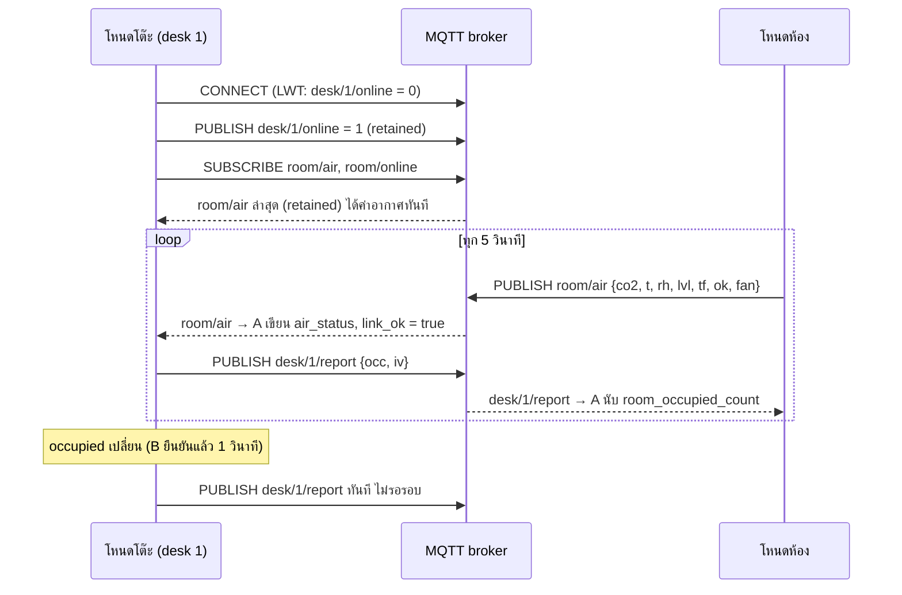
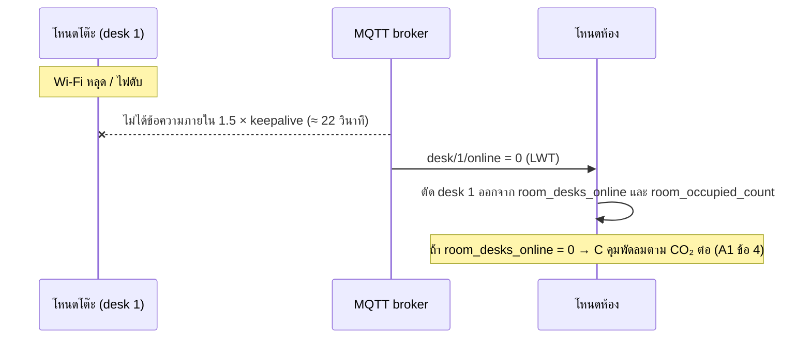

# A3 การสื่อสารระหว่างโหนด

| รายการ | ค่า |
|---|---|
| เวอร์ชัน | v1.0 |
| วันที่ | 2026-10-14 |
| เจ้าของ | A |
| ส่งให้ | B (งานย่อยด้านสื่อสารใน B3), D (เล่มหัวข้อ 5), C (พฤติกรรมเมื่อโต๊ะหลุด) |
| อ้างอิง | `02_interface/A1_interface.md` v1.0, `01_requirements/D1_requirements.md` (FR-19, FR-20, NFR-06, NFR-08, NFR-13, NFR-16) |

> เนื้อหาข้อ 1–7 ใช้ลงเล่มหัวข้อ 5 (Communication protocols) ได้ทันที

---

## 1. สรุปการออกแบบ

| เรื่อง | เลือก | เหตุผลสั้นๆ |
|---|---|---|
| สื่อกลางไร้สาย | **Wi-Fi 2.4 GHz (802.11 b/g/n)** | มีใน ESP32 อยู่แล้ว ใช้ router ของห้องได้เลย และต้องมี Wi-Fi อยู่แล้วเพื่อดึงเวลา NTP (FR-20) |
| โปรโตคอลรับส่งข้อความ | **MQTT 3.1.1** แบบ publish/subscribe ผ่าน broker | เพิ่มโต๊ะได้โดยไม่แก้โหนดห้อง (NFR-13), มีกลไก Last Will บอกว่าโหนดหลุด, และเป็นวิธีเดียวที่ 2 โหนดใน Wokwi คุยกันได้ |
| รูปแบบข้อมูล | **JSON** ขนาดไม่เกิน 100 ไบต์ต่อข้อความ | อ่านง่ายตอน debug ใน Serial Monitor และ MQTT client ข้อความเล็กมากจึงไม่เปลือง |
| เวลา | **SNTP** ซิงก์ตอนเปิดเครื่องและทุก 1 ชั่วโมง เขตเวลา UTC+7 | ตามตารางงานย่อยในไฟล์ภาพรวมข้อ 6 |
| ความถี่ | ทุก 5 วินาที + ส่งทันทีเมื่อ `occupied` เปลี่ยน | ทัน NFR-01 (10 วินาที) และไม่เปิดวิทยุส่งตลอดเวลา |

---

## 2. ทำไมเลือก Wi-Fi (เทียบ Bluetooth และ Zigbee, บท 23 หน้า 51–79)

| เกณฑ์ | **Wi-Fi** | Bluetooth Low Energy | Zigbee |
|---|---|---|---|
| มีใน ESP32 ไหม | ✅ มีในตัว | ✅ มีในตัว | ❌ ไม่มี ต้องเพิ่มโมดูล 802.15.4 และตัวประสาน (coordinator) |
| ใช้โครงสร้างที่ห้องมีอยู่แล้ว | ✅ router ของห้อง | ❌ ต้องมีตัวกลางรับจากหลายโต๊ะ | ❌ ต้องมี coordinator แยก |
| ต่อออกอินเทอร์เน็ตได้ (NTP, cloud ในอนาคต บท 24) | ✅ ได้ตรง | ❌ ต้องมี gateway | ❌ ต้องมี gateway |
| พลังงาน | ⚠️ สูงที่สุด (ส่ง 240 mA ที่ +19.5 dBm [A3-1]) | ✅ ต่ำ | ✅ ต่ำ |
| ระยะในห้องทำงาน | ✅ ครอบคลุมทั้งห้อง | ⚠️ พอใช้ | ✅ ทำ mesh ได้ |
| จำลองใน Wokwi | ✅ ได้ (เครือข่าย `Wokwi-GUEST`) | ❌ | ❌ |

**สรุป:** ข้อเสียเดียวของ Wi-Fi คือกินไฟ แต่ทั้งสองโหนดเสียบไฟ adapter 12 V ตลอด ไม่ได้ใช้แบตเตอรี่ และระบบส่งข้อมูลแค่ทุก 5 วินาที ระหว่างนั้นวิทยุเข้า modem-sleep (ดูข้อ 7) จึงยอมรับได้ ส่วน BLE และ Zigbee ประหยัดไฟกว่าแต่ต้องเพิ่มอุปกรณ์ตัวกลาง และยังต้องมี Wi-Fi อยู่ดีเพื่อดึงเวลา NTP

**ทางเลือกที่พิจารณาแล้วไม่เลือก: ESP-NOW** (โปรโตคอลของ Espressif ที่ส่งตรงระหว่าง ESP32 โดยไม่ผ่าน router) เร็วและประหยัด แต่ (1) เป็นโปรโตคอลเฉพาะของผู้ผลิต (2) ยังต้องต่อ Wi-Fi เพื่อดึง NTP และใช้ช่องสัญญาณเดียวกับ router อยู่ดี (3) ต่อ cloud ในอนาคตไม่ได้ (4) จำลองข้ามโปรเจค Wokwi ไม่ได้

## 3. ทำไมเลือก MQTT

| ทางเลือก | ข้อดี | ข้อเสีย | ผล |
|---|---|---|---|
| **MQTT ผ่าน broker** | publish/subscribe: โต๊ะใหม่แค่ publish หัวข้อของตัวเอง โหนดห้องไม่ต้องรู้ล่วงหน้าว่ามีกี่โต๊ะ (NFR-13) · มี Last Will and Testament (LWT) ให้ broker ประกาศแทนเมื่อโหนดหลุด · มีข้อความ retained ให้โต๊ะที่เพิ่งต่อได้ค่าอากาศล่าสุดทันที · header เล็ก 2 ไบต์ [A3-2] | ต้องมี broker 1 ตัว | ✅ **เลือก** |
| HTTP (โหนดห้องเป็น web server) | เข้าใจง่าย | โต๊ะต้องถามซ้ำๆ (polling) · ห้องต้องเก็บรายชื่อโต๊ะเอง · header ใหญ่ · ใน Wokwi โหนดรับการเชื่อมต่อเข้าจากภายนอกไม่ได้ | ❌ |
| UDP broadcast | ไม่ต้องมี broker | ไม่มีการยืนยัน ไม่มี LWT ต้องเขียนกลไกเองทั้งหมด · router บางรุ่นกรอง broadcast | ❌ |

**broker อยู่ที่ไหน**

| สภาพแวดล้อม | broker | เหตุผล |
|---|---|---|
| ใช้งานจริง | Mosquitto บนเครื่องในเครือข่ายเดียวกัน (เช่น Raspberry Pi หรือ router ที่รองรับ) | อยู่ภายในห้อง ไม่ต้องพึ่งอินเทอร์เน็ต ถ้าเน็ตล่มระบบยังคุยกันได้ (บท 24 หน้า 18–20) |
| โปรแกรมจำลอง Wokwi | broker สาธารณะ `broker.hivemq.com` พอร์ต 1883 ผ่านเครือข่าย `Wokwi-GUEST` | โหนดโต๊ะและโหนดห้องเปิดเป็นคนละโปรเจค Wokwi จึงคุยกันได้ทางอินเทอร์เน็ตเท่านั้น ใช้ prefix หัวข้อเฉพาะทีมที่ไม่ซ้ำคนอื่น (กำหนดในโค้ด A4 เช่น `swer-<รหัสสุ่ม>/r1/...`) และไม่ส่งข้อมูลส่วนตัว |

## 4. หัวข้อ (topic) และรูปแบบข้อความ

prefix ทุกหัวข้อ: `swer/<room_id>/` เช่น `swer/r1/`

| หัวข้อ | ผู้ส่ง → ผู้รับ | QoS | Retained | เนื้อหา | ส่งเมื่อ |
|---|---|---|---|---|---|
| `desk/<desk_id>/report` | โต๊ะ → ห้อง | 0 | ไม่ | `{"seq":812,"occ":1,"iv":5}` | ทุก `iv` วินาที และทันทีเมื่อ `occupied` เปลี่ยน |
| `desk/<desk_id>/online` | โต๊ะ → ห้อง | 1 | ใช่ | `1` ตอนเชื่อมต่อ / `0` เป็น LWT | ตอนต่อ broker สำเร็จ (broker ส่ง `0` แทนเมื่อโต๊ะหลุด) |
| `room/air` | ห้อง → ทุกโต๊ะ | 0 | ใช่ | `{"seq":95,"co2":1043,"t":251,"rh":58,"lvl":2,"tf":0,"ok":1,"fan":100}` | ทุก 5 วินาทีหลังอ่าน SCD41 |
| `room/online` | ห้อง → ทุกโต๊ะ | 1 | ใช่ | `1` / `0` เป็น LWT | เหมือน `desk/.../online` |

**ตารางแปลงชื่อฟิลด์ (ชื่อสั้นในข้อความ ↔ ชื่อใน A1)**

| ในข้อความ | ใน A1 | | ในข้อความ | ใน A1 |
|---|---|---|---|---|
| `occ` | `occupied` | | `lvl` | `co2_level` |
| `iv` | `report_interval_s` | | `tf` | `temp_flag` |
| `co2` | `co2_ppm` | | `ok` | `sensor_ok` |
| `t` | `temp_c_x10` | | `fan` | `fan_pct` |
| `rh` | `rh_pct` | | `seq` | `seq` |

`desk_id` อยู่ในชื่อหัวข้อแล้ว จึงไม่ต้องซ้ำในเนื้อข้อความ

**ทำไม QoS 0 สำหรับข้อมูลรายรอบ:** ข้อมูลเป็น "สถานะล่าสุด" ที่ส่งซ้ำทุก 5 วินาที ถ้าข้อความหนึ่งหาย ข้อความถัดไปก็มาแทน การส่งยืนยัน (QoS 1) จะเพิ่มข้อความไปกลับโดยไม่ได้ประโยชน์ ส่วนหัวข้อ `online` ใช้ QoS 1 + retained เพราะเปลี่ยนนานๆ ครั้ง และต้องไม่พลาด

**ปริมาณข้อมูล:** ข้อความใหญ่สุดประมาณ 80 ไบต์ ทุก 5 วินาที ≈ 16 ไบต์ต่อวินาทีต่อโหนด น้อยมากเมื่อเทียบกับ Wi-Fi ที่รับได้หลาย Mbit/s

## 5. ลำดับการทำงาน

### 5.1 ปกติ



### 5.2 โต๊ะหลุด



## 6. เมื่อการสื่อสารผิดพลาด (ตรวจจับ → ตอบสนอง → แจ้งเตือน, บท 6 หน้า 22–26)

| เหตุการณ์ | ตรวจจับอย่างไร | โหนดโต๊ะทำอะไร | โหนดห้องทำอะไร | แจ้งเตือน |
|---|---|---|---|---|
| Wi-Fi หรือ broker หลุด | `WiFi.status()` ไม่ใช่ connected หรือ MQTT client หลุด | ตรวจคน คุมแสง เตือนพักทำงานต่อครบ เพราะคิดในโหนดเอง (NFR-06) · ตั้ง `link_ok = false` · `air_status` แก่ขึ้นจนเกิน 15 วินาที | คุมพัดลมตาม CO₂ ต่อ ไม่ปิดพัดลมเพราะเห็นว่าไม่มีโต๊ะ | B แสดงไอคอนลิงก์ขาด (`ALERT_LINK_LOST` priority 0) |
| ไม่ได้ `room/air` เกิน 15 วินาที แต่ยังต่อ broker ได้ | อายุของ `air_status` (`age_s > 15`) | เหมือนแถวบน และขึ้น "ไม่มีข้อมูลอากาศ" | — | เหมือนแถวบน |
| โต๊ะหนึ่งไม่ส่ง `report` เกิน 3 × `iv` หรือได้ LWT `0` | เวลาที่ได้รับล่าสุดของโต๊ะนั้น | — | ตัดโต๊ะนั้นออกจากการนับ | — |
| ข้อความเสีย (JSON อ่านไม่ได้ หรือค่าเกินช่วง) | ตรวจรูปแบบและช่วงค่าทุกข้อความ | ทิ้งข้อความ ใช้ค่าเดิม นับ error | ทิ้งข้อความ นับ error | บันทึกใน Serial log |
| `seq` กระโดด | `seq` ใหม่ ≠ เดิม + 1 | นับจำนวนข้อความที่หาย (ใช้ในผลทดสอบ A5) | เหมือนกัน | — |

**การต่อกลับ:** ลองต่อใหม่แบบเว้นช่วงเพิ่มขึ้นเรื่อยๆ 1, 2, 4, 8, … สูงสุด 60 วินาที (exponential backoff) เพื่อไม่ให้ทุกโหนดรุมต่อ router พร้อมกันตอนไฟกลับมา งานสื่อสารเป็นงานเดียวที่รอเครือข่าย และรอแบบ block โดยไม่ถือ mutex งานอื่นจึงไม่ช้าลง

## 7. เวลาจริงจาก NTP (บท 16 หน้า 23–29)

| เรื่อง | ค่า |
|---|---|
| วิธี | SNTP client ที่มากับ ESP32 (`configTzTime`) |
| server | `time.navy.mi.th` (กองทัพเรือ, เวลามาตรฐานประเทศไทย), `clock.nectec.or.th`, `pool.ntp.org` (สำรอง) |
| เขตเวลา | `ICT-7` (UTC+7 ไม่มีเวลาออมแสง) |
| ซิงก์เมื่อไร | ตอนต่อ Wi-Fi สำเร็จครั้งแรก และทุก 1 ชั่วโมง |
| ระหว่างไม่มีเน็ต | นาฬิกาในตัว ESP32 นับต่อ (FR-20) คริสตัล 40 MHz คลาดเคลื่อนระดับ ppm จึงคลาดไม่ถึง 1 วินาทีต่อชั่วโมง พอสำหรับเลือกสีแสงที่ละเอียดระดับนาที |
| `time_valid` | `false` ตอนเปิดเครื่อง → `true` เมื่อซิงก์สำเร็จครั้งแรก (callback ของ SNTP) และคงเป็น `true` แม้ Wi-Fi หลุดภายหลัง |
| โหนดห้อง | ไม่ดึงเวลา เพราะไม่มีฟีเจอร์ไหนในโหนดห้องที่ใช้เวลาจริง (ลดงานที่ไม่จำเป็น) |

## 8. พลังงานด้านการสื่อสาร (บท 10 หน้า 21–26)

- **ทำไมไม่ส่งตลอดเวลา:** วิทยุ Wi-Fi ตอนส่งกินไฟสูงสุด 240 mA ขณะที่ CPU ทำงานแบบ modem-sleep กิน 20–68 mA [A3-1] การสื่อสารจึงเป็นตัวกินไฟหลักมากกว่าการประมวลผล (บท 10 หน้า 22) ระบบจึงส่งเป็นรอบและเปิด modem-sleep ระหว่างรอบ
- **ลดรอบเมื่อไม่มีคน (NFR-08):** เมื่อ `away_timeout = true` โต๊ะเปลี่ยน `iv` จาก 5 เป็น 15 วินาที และแจ้ง `iv` ในข้อความ ให้โหนดห้องปรับเกณฑ์ตัดสินว่าโต๊ะหลุดเป็น 45 วินาทีเอง เมื่อมีคนกลับมา โต๊ะส่งทันทีจึงไม่ช้าลง
- งาน light-sleep หรือ deep-sleep ของ CPU ไม่ใช้ในเวอร์ชันนี้ เพราะต้องคงการเชื่อมต่อ Wi-Fi ไว้รับ `room/air` และ LD2410 ต้องทำงานต่อเพื่อตรวจคนกลับมา (บันทึกเป็นแนวทางพัฒนาต่อในหัวข้อ 9)

## 9. ความปลอดภัยและความเป็นส่วนตัว (บท 26 หน้า 21–26)

| ความเสี่ยง | การป้องกันในระบบจริง |
|---|---|
| คนนอกดักฟังหรือส่งข้อมูลปลอม | Wi-Fi WPA2, broker ในเครือข่ายภายใน, MQTT ใช้ username/password แยกต่อโหนด และจำกัดสิทธิ์รายหัวข้อ (ACL) |
| ข้อมูลการนั่งรายคน | ใช้เฉพาะในห้อง ถ้าส่ง cloud ในอนาคตส่งแค่ค่ารวมของห้อง (NFR-16) |
| ใน Wokwi ใช้ broker สาธารณะ | ส่งเฉพาะข้อมูลจำลอง ไม่มีข้อมูลส่วนตัว ระบุเป็นข้อจำกัดของการจำลองในหัวข้อ 8 |

## 10. ข้อมูลรับเข้าและส่งออก (ตาม A1)

| โหนด | รับเข้า | ส่งออก |
|---|---|---|
| โต๊ะ | `occupied`, `away_timeout` (จาก B) · `room/air`, `room/online` (จาก broker) | `air_status` (สำเนา), `link_ok`, `time_of_day`, `time_valid`, `alert_request` (`ALERT_LINK_LOST`) · `desk/<id>/report`, `desk/<id>/online` |
| ห้อง | `air_status` (จาก C) · `desk/+/report`, `desk/+/online` (จาก broker) | `room_occupied_count`, `room_desks_online` · `room/air`, `room/online` |

## 11. Pseudocode งานสื่อสาร

```text
// ===== โหนดโต๊ะ: desk_communication_task (A) =====
CONST IV_NORMAL = 5 s, IV_AWAY = 15 s, STALE = 15 s
on boot:
    time_valid = false; link_ok = false
    wifi_begin(SSID); configTzTime("ICT-7", NTP_SERVERS)    // SNTP ซิงก์เองทุก 1 ชม.
    mqtt_set_will("swer/r1/desk/<ID>/online", "0", qos=1, retain=true)

loop forever:
    event = wait_notify(timeout = iv)          // block: ตื่นเมื่อครบรอบ หรือ B แจ้งว่า occupied เปลี่ยน
    if not wifi_connected() or not mqtt_connected():
        set link_ok = false; send_alert_once(ALERT_LINK_LOST, prio 0, SHOW)
        try_reconnect_with_backoff()           // 1,2,4,…,60 s ไม่ถือ mutex
        continue
    snap = read_snapshot(occupied, away_timeout)    // mutex สั้นๆ
    iv = snap.away_timeout ? IV_AWAY : IV_NORMAL
    mqtt_publish("…/desk/<ID>/report", {seq++, occ: snap.occupied, iv}, qos 0)
    age = now - last_room_air_time
    write_shared(air_status.age_s = age)
    new_link = (age <= STALE) and room_online
    if new_link != link_ok:
        link_ok = new_link
        send_alert(ALERT_LINK_LOST, prio 0, new_link ? CLEAR : SHOW)

on mqtt message "…/room/air":                  // callback ทำงานสั้น
    if parse_ok and in_range: write_shared(air_status ← msg); last_room_air_time = now
    else: error_count++

on sntp synced: time_valid = true
every 1 min: time_of_day = localtime(now)      // ทำใน desk_communication_task หรือ timer

// ===== โหนดห้อง: room_communication_task (A) =====
table desks[id] = {occ, iv, last_seen, online}
loop forever:
    wait_notify(from air_sensor_task, timeout = 5 s)   // ส่งหลังอ่าน SCD41 ทุกรอบ
    snap = read_snapshot(air_status)
    mqtt_publish("…/room/air", {seq++, snap fields}, qos 0, retain = true)
    online = 0; occupied = 0
    for each desk in desks:
        alive = desk.online and (now - desk.last_seen) <= 3 × desk.iv
        if alive: online++; if desk.occ: occupied++
    write_shared(room_desks_online = online, room_occupied_count = occupied)

on mqtt message "…/desk/<id>/report": desks[id] ← {occ, iv, last_seen = now, online = true}
on mqtt message "…/desk/<id>/online" = "0": desks[id].online = false
```

## อ้างอิง

[A3-1] Espressif Systems, "ESP32 Series Datasheet," v5.3, Table 4-2 และหัวข้อ 5.4. (มีใน repo: `03_hardware/datasheets/ESP32_series_datasheet_v5.3.pdf`)

[A3-2] OASIS, "MQTT Version 3.1.1," OASIS Standard, Oct. 2014. [Online]. Available: https://docs.oasis-open.org/mqtt/mqtt/v3.1.1/mqtt-v3.1.1.html

[A3-3] Espressif Systems, "System Time," *ESP-IDF Programming Guide*. [Online]. Available: https://docs.espressif.com/projects/esp-idf/en/stable/esp32/api-reference/system/system_time.html

[A3-4] Espressif Systems, "Wi-Fi Driver: Station Sleep," *ESP-IDF Programming Guide*. [Online]. Available: https://docs.espressif.com/projects/esp-idf/en/stable/esp32/api-guides/wifi.html
