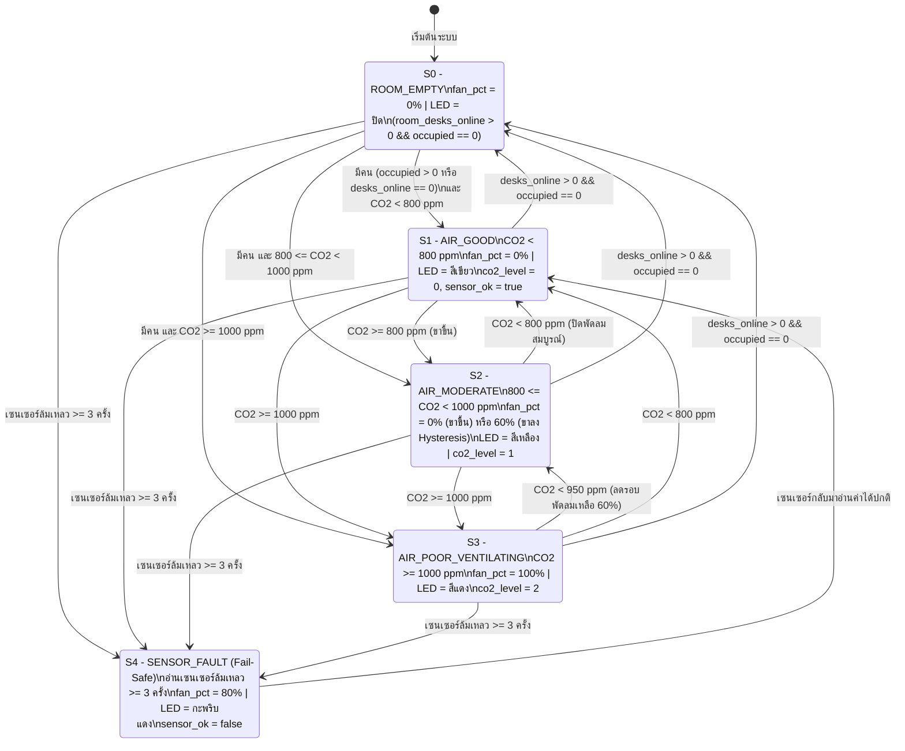

# C2: การออกแบบซอฟต์แวร์และลอจิก โมดูลตรวจวัดคุณภาพอากาศและควบคุมพัดลม

> **รหัสเอกสาร:** C2_logic_air  
> **ผู้จัดทำ:** C (ซัน - นายทิวากร ฉับพลัน 6701012610112) | โมดูลอากาศ + ภาพจำลอง + แผนทดสอบ  
> **ส่งให้:** A (โอม - นำไปเขียนโค้ด FreeRTOS บนโหนดห้อง), D (ใช้รวมเล่มหัวข้อ 5)  
> **อ้างอิงและสอดคล้องกับ:** `02_interface/A1_interface.md` v1.0, `01_requirements/D1_requirements.md`  
> **เนื้อหาสำหรับรายงาน:** หัวข้อ 5 (Software Design - Flowcharts/UML, Pseudocode)

---

## 1. สถานะทั้งหมดของระบบ (Finite State Machine - FSM States)

ระบบควบคุมคุณภาพอากาศบนโหนดห้อง (Room Node) ทำงานภายใต้ระบบปฏิบัติการ FreeRTOS ทุกรอบคาบเวลา 5,000 ms โดยแบ่งออกเป็น **5 สถานะหลัก** ดังนี้:

| รหัสสถานะ | ชื่อสถานะ | ความหมายและการทำงานหลัก |
|---|---|---|
| **S0** | `ROOM_EMPTY` (ห้องว่าง - โหมดประหยัดพลังงาน) | เข้าสู่สถานะนี้เมื่อ **`room_desks_online > 0` และ `room_occupied_count == 0`** (มีการเชื่อมต่อกับโต๊ะอย่างน้อย 1 ตัว และทุกโต๊ะยืนยันว่าไม่มีคนนั่ง)<br>- พัดลมดูดอากาศปิด (`fan_pct = 0%`)<br>- ไฟสถานะ RGB ดับ (`OFF`) เพื่อประหยัดพลังงาน<br>- ยังคงอ่านค่าเซนเซอร์ทุก 5 วินาที เพื่อเก็บข้อมูลสภาวะห้องและอัปเดตลงโครงสร้าง `air_status_t` |
| **S1** | `AIR_GOOD` (อากาศดี - ปกติ) | มีคนในห้อง หรือไม่ทราบสถานะคน (`room_desks_online == 0`) และระดับ $\text{CO}_2 < 800\ \text{ppm}$<br>- พัดลมดูดอากาศปิด (`fan_pct = 0%`)<br>- ไฟสถานะ RGB แสดง **สีเขียว**<br>- ค่าฟิลด์ `co2_level = 0`, `sensor_ok = true` |
| **S2** | `AIR_MODERATE` (อากาศเริ่มสะสม - เฝ้าระวัง Hysteresis) | มีคนในห้อง และระดับ $800\ \text{ppm} \le \text{CO}_2 < 1000\ \text{ppm}$<br>- ไฟสถานะ RGB แสดง **สีเหลือง** (`co2_level = 1`)<br>- **กรณีขาขึ้น (มาจาก S1):** พัดลมยังคงปิด (`fan_pct = 0%`) เพื่อรอดูแนวโน้ม<br>- **กรณีขาลง (มาจาก S3 ระบายอากาศลงมา):** พัดลมยังคงทำงานต่อเนื่องที่ความเร็วปานกลาง (`fan_pct = 60%`) จนกว่า $\text{CO}_2$ จะลดต่ำกว่า $800\ \text{ppm}$ ตามหลักการ **Hysteresis Band** เพื่อป้องกันการตัดต่อถี่ |
| **S3** | `AIR_POOR_VENTILATING` (อากาศแย่ - เร่งระบายอากาศ) | มีคนในห้อง และระดับ $\text{CO}_2 \ge 1000\ \text{ppm}$ (ตรงตามข้อกำหนด FR-13, FR-14 และงานวิจัย [2])<br>- พัดลมดูดอากาศทำงานเต็มกำลัง (`fan_pct = 100%`)<br>- ไฟสถานะ RGB แสดง **สีแดง** (`co2_level = 2`)<br>- โหนดโต๊ะที่ได้รับค่า `co2_level = 2` จะแสดงคำเตือนบนหน้าจอ OLED และส่งเสียง Buzzer สั้นตามที่โมดูล B กำหนด |
| **S4** | `SENSOR_FAULT` (โหมดนิรภัย Fail-Safe เมื่อเซนเซอร์ขัดข้อง) | เซนเซอร์ SCD41 อ่านค่าไม่ได้ติดต่อกันครบ 3 รอบ (15 วินาที ตามเกณฑ์ NFR-07) หรือค่าหลุดช่วงสมเหตุสมผล ($\text{CO}_2 < 300$ หรือ $> 5000\ \text{ppm}$)<br>- เข้าสู่สถานะนิรภัย **Fail-Open Policy** ตามสไลด์บทที่ 6 หน้า 22–26 บังคับพัดลมดูดอากาศทำงานที่ `fan_pct = 80%` ค้างไว้เพื่อความปลอดภัย<br>- ไฟสถานะ RGB **กะพริบสีแดง** (Blinking Red)<br>- กำหนดค่าแฟล็ก `sensor_ok = false` ในโครงสร้าง `air_status_t` เพื่อให้โหนดโต๊ะรับทราบและแสดงไอคอนแจ้งเตือนเซนเซอร์ขัดข้องบนหน้าจอ |

---

## 2. ตารางเปลี่ยนสถานะ (State Transition Table)

| จากสถานะ | ไปสถานะ | เงื่อนไขการเปลี่ยนสถานะ (Guard Condition) | การทำงานของระบบ (Action) |
|---|---|---|---|
| ทุกสถานะ (ยกเว้น S4) | `S4: SENSOR_FAULT` | อ่านค่าผิดพลาดติดต่อกัน $\ge 3$ ครั้ง (`fault_counter >= 3`) หรือค่าหลุดช่วง $300 \le \text{CO}_2 \le 5000$ | `fan_pct = 80`, ไฟ RGB กะพริบสีแดง, `sensor_ok = false` |
| `S4: SENSOR_FAULT` | `S1` หรือ `S0` | อ่านค่าสำเร็จติดต่อกันครบ 2 ครั้ง (`fault_counter == 0`) | `sensor_ok = true`, ยกเลิก Fail-Safe และกลับสู่สถานะตามค่าตรวจวัดจริง |
| `S1`, `S2`, `S3` | `S0: ROOM_EMPTY` | `room_desks_online > 0` และ `room_occupied_count == 0` (ทุกโต๊ะรายงานว่าไม่มีคน) | `fan_pct = 0`, ไฟ RGB = ดับ (OFF), `co2_level = 0` |
| `S0: ROOM_EMPTY` | `S1: AIR_GOOD` | (`room_occupied_count > 0` หรือ `room_desks_online == 0`) และ $\text{CO}_2 < 800\ \text{ppm}$ | `fan_pct = 0`, ไฟ RGB = สีเขียว, `co2_level = 0` |
| `S0: ROOM_EMPTY` | `S2: AIR_MODERATE` | (`room_occupied_count > 0` หรือ `room_desks_online == 0`) และ $800 \le \text{CO}_2 < 1000\ \text{ppm}$ | `fan_pct = 0`, ไฟ RGB = สีเหลือง, `co2_level = 1` |
| `S0: ROOM_EMPTY` | `S3: AIR_POOR` | (`room_occupied_count > 0` หรือ `room_desks_online == 0`) และ $\text{CO}_2 \ge 1000\ \text{ppm}$ | `fan_pct = 100`, ไฟ RGB = สีแดง, `co2_level = 2` |
| `S1: AIR_GOOD` | `S2: AIR_MODERATE` | $\text{CO}_2 \ge 800\ \text{ppm}$ (ขาขึ้น) และ $\text{CO}_2 < 1000\ \text{ppm}$ | คงค่า `fan_pct = 0`, ไฟ RGB = สีเหลือง, `co2_level = 1` |
| `S1: AIR_GOOD` | `S3: AIR_POOR` | $\text{CO}_2 \ge 1000\ \text{ppm}$ (เพิ่มขึ้นรวดเร็ว) | `fan_pct = 100`, ไฟ RGB = สีแดง, `co2_level = 2` |
| `S2: AIR_MODERATE` | `S3: AIR_POOR` | $\text{CO}_2 \ge 1000\ \text{ppm}$ | `fan_pct = 100`, ไฟ RGB = สีแดง, `co2_level = 2` |
| `S2: AIR_MODERATE` | `S1: AIR_GOOD` | $\text{CO}_2 < 800\ \text{ppm}$ (ผ่านจุดตัด Hysteresis ล่าง) | `fan_pct = 0`, ไฟ RGB = สีเขียว, `co2_level = 0` |
| `S3: AIR_POOR` | `S2: AIR_MODERATE` | $800 \le \text{CO}_2 < 950\ \text{ppm}$ (เริ่มระบายอากาศได้ผล) | ลดรอบพัดลมเป็น `fan_pct = 60`, ไฟ RGB = สีเหลือง, `co2_level = 1` |
| `S3: AIR_POOR` | `S1: AIR_GOOD` | $\text{CO}_2 < 800\ \text{ppm}$ (ระบายอากาศสะอาดสมบูรณ์) | `fan_pct = 0`, ไฟ RGB = สีเขียว, `co2_level = 0` |

> **ข้อกำหนดการทำงานเมื่อการเชื่อมต่อ Wi-Fi ขาดหาย (ตาม A1 ข้อ 4 และ NFR-06):**  
> หาก `room_desks_online == 0` (เช่น Wi-Fi หลุด หรือโหนดโต๊ะดับ) โหนดห้องจะ **ไม่เข้าสู่สถานะ ROOM_EMPTY** เพราะไม่สามารถยืนยันได้ว่าห้องว่างจริง โหนดห้องจะตัดสินใจควบคุมพัดลมดูดอากาศตามระดับ $\text{CO}_2$ ที่วัดได้จริงอย่างอิสระ (Local Autonomous Resilience) เพื่อความปลอดภัยของผู้ใช้งานในห้อง

---

## 3. แผนภาพสถานะ (FSM State Diagram)



*(หมายเหตุ: ไฟล์ภาพ PNG ของแผนภาพ FSM ถูกบันทึกไว้ที่ `07_visuals/C2_fsm_air_quality.png`)*

---

## 4. รหัสเทียม (Pseudocode สำหรับ A นำไปเขียนโค้ด FreeRTOS)

```c
// ============================================================================
// โมดูลตรวจวัดคุณภาพอากาศและควบคุมการระบายอากาศ (โหนดห้อง - Room Node)
// ฟังก์ชันงานย่อย FreeRTOS: Task_AirQuality (Period = 5000 ms)
// โครงสร้างข้อมูลยึดตาม A1_interface.md v1.0 และข้อกำหนด D1
// ============================================================================

#define CO2_HIGH_LIMIT       1000   // เกณฑ์เปิดพัดลมดูดอากาศเต็มกำลัง [FR-13]
#define CO2_HYST_MID         950    // เกณฑ์ลดความเร็วรอบพัดลมลงมาที่ระดับกลาง
#define CO2_LOW_LIMIT        800    // เกณฑ์ปิดพัดลมสมบูรณ์ (Hysteresis Band = 200 ppm)
#define TEMP_LOW_LIMIT_X10   200    // 20.0 °C (เตือนเมื่อ temp_c_x10 < 200) [FR-17]
#define TEMP_HIGH_LIMIT_X10  260    // 26.0 °C (เตือนเมื่อ temp_c_x10 > 260) [FR-17]
#define MAX_SENSOR_FAULTS    3      // จำนวนรอบที่อ่านล้มเหลวติดต่อกันก่อนเข้า Fail-Safe [NFR-07]

// โครงสร้างข้อมูลกลางตาม A1_interface.md v1.0
typedef struct {
    uint16_t co2_ppm;       // ความเข้มข้น CO2 (ppm)
    int16_t  temp_c_x10;    // อุณหภูมิ x 10 (เช่น 235 = 23.5 °C)
    uint8_t  rh_pct;        // ความชื้นสัมพัทธ์ (%RH)
    uint8_t  co2_level;     // ระดับเตือน CO2: 0 ดี / 1 เริ่มแย่ / 2 แย่
    uint8_t  temp_flag;     // อุณหภูมิ: 0 ปกติ / 1 เย็นเกิน (<20°C) / 2 ร้อนเกิน (>26°C)
    bool     sensor_ok;     // สถานะเซนเซอร์: true = ปกติ, false = ขัดข้อง
    uint8_t  fan_pct;       // ความเร็วรอบพัดลมดูดอากาศ: 0 - 100%
} air_status_t;

typedef enum {
    STATE_ROOM_EMPTY = 0,
    STATE_AIR_GOOD,
    STATE_AIR_MODERATE,
    STATE_AIR_POOR,
    STATE_SENSOR_FAULT
} room_fsm_state_t;

// ตัวแปรส่วนกลาง (Shared Variables)
air_status_t     air_status;
room_fsm_state_t current_state = STATE_ROOM_EMPTY;
uint8_t          sensor_fault_count = 0;
uint8_t          sensor_ok_count = 0;        // นับรอบอ่านสำเร็จเพื่อฟื้นคืนสถานะ (RECOVER_READS = 2)
bool             fan_was_ventilating = false;

void Task_AirQuality(void *pvParameters) {
    TickType_t xLastWakeTime = xTaskGetTickCount();
    const TickType_t xPeriod = pdMS_TO_TICKS(5000); // ทำงานทุก 5,000 ms

    for (;;) {
        bool read_success = false;
        uint16_t raw_co2 = 0;
        int16_t raw_temp_x10 = 0;
        uint8_t raw_rh = 0;

        // 1. อ่านข้อมูลเซนเซอร์ SCD41 ผ่าน I2C บัส พร้อม Mutex Protection
        if (xSemaphoreTake(i2c_lock, pdMS_TO_TICKS(50)) == pdTRUE) {
            read_success = SCD41_ReadMeasurement(&raw_co2, &raw_temp_x10, &raw_rh);
            xSemaphoreGive(i2c_lock);
        } else {
            read_success = false; // รอล็อกเกิน 50 ms ถือเป็นความผิดพลาด
        }

        // 2. ตรวจสอบความถูกต้องของข้อมูล (Sanity Check & Fault Detection - NFR-07)
        if (!read_success || raw_co2 < 300 || raw_co2 > 5000) {
            sensor_fault_count++;
            sensor_ok_count = 0;
        } else {
            sensor_fault_count = 0;
            sensor_ok_count++;
            air_status.co2_ppm = raw_co2;
            air_status.temp_c_x10 = raw_temp_x10;
            air_status.rh_pct = raw_rh;
        }

        // 3. อัปเดตข้อมูลสถานะโต๊ะทำงานแบบ Real-time ก่อนประเมิน FSM [A3, A5 Bug #8]
        comm_update_counts();

        // 4. ประมวลผลและเปลี่ยนสถานะ FSM (C2 FSM Logic)
        if (sensor_fault_count >= MAX_SENSOR_FAULTS || (current_state == STATE_SENSOR_FAULT && sensor_ok_count < 2)) {
            current_state = STATE_SENSOR_FAULT;
        } else if (room_desks_online > 0 && room_occupied_count == 0) {
            // ห้องว่างเฉพาะเมื่อมีการต่อโต๊ะอยู่และทุกโต๊ะไม่มีคน [FR-15, A1 ข้อ 4]
            current_state = STATE_ROOM_EMPTY;
            fan_was_ventilating = false;
        } else {
            // กรณีมีคนอยู่ในห้อง หรือ Wi-Fi หลุด (room_desks_online == 0 ให้คุมต่อตาม NFR-06)
            if (air_status.co2_ppm >= CO2_HIGH_LIMIT) {
                current_state = STATE_AIR_POOR;
                fan_was_ventilating = true;
            } else if (air_status.co2_ppm < CO2_LOW_LIMIT) {
                current_state = STATE_AIR_GOOD;
                fan_was_ventilating = false;
            } else {
                // ช่วงเฝ้าระวัง Hysteresis (800 <= CO2 < 1000 ppm)
                if (fan_was_ventilating && air_status.co2_ppm >= CO2_HYST_MID) {
                    current_state = STATE_AIR_POOR; // คงรอบ 100% จนกว่าจะต่ำกว่า 950 ppm
                } else {
                    current_state = STATE_AIR_MODERATE;
                }
            }
        }

        // 4. สั่งการ Actuator และอัปเดตฟิลด์ใน air_status (ไม่มี SEND_ALERT ในโหนดห้อง)
        switch (current_state) {
            case STATE_ROOM_EMPTY:
                air_status.fan_pct = 0;
                air_status.co2_level = 0;
                air_status.sensor_ok = true;
                Set_Fan_PWM_Duty(0);
                Set_RGB_LED(COLOR_OFF);
                break;

            case STATE_AIR_GOOD:
                air_status.fan_pct = 0;
                air_status.co2_level = 0;
                air_status.sensor_ok = true;
                Set_Fan_PWM_Duty(0);
                Set_RGB_LED(COLOR_GREEN);
                break;

            case STATE_AIR_MODERATE:
                if (fan_was_ventilating) {
                    air_status.fan_pct = 60; // ขาลง: หมุนต่อแบบเบาช่วยดึง CO2 ให้พ้นเกณฑ์
                } else {
                    air_status.fan_pct = 0;  // ขาขึ้น: ยังไม่เปิดพัดลม
                }
                air_status.co2_level = 1;
                air_status.sensor_ok = true;
                Set_Fan_PWM_Duty(air_status.fan_pct);
                Set_RGB_LED(COLOR_YELLOW);
                break;

            case STATE_AIR_POOR:
                air_status.fan_pct = 100;    // เร่งระบายอากาศเต็มกำลัง
                air_status.co2_level = 2;
                air_status.sensor_ok = true;
                Set_Fan_PWM_Duty(100);
                Set_RGB_LED(COLOR_RED);
                break;

            case STATE_SENSOR_FAULT:
                air_status.fan_pct = 80;     // Fail-Safe: บังคับระบายอากาศเพื่อความปลอดภัย
                air_status.co2_level = 2;
                air_status.sensor_ok = false; // แฟล็กแจ้งโต๊ะว่าเซนเซอร์เสีย
                Set_Fan_PWM_Duty(80);
                Set_RGB_LED(COLOR_BLINK_RED);
                break;
        }

        // 5. ตรวจสอบสถานะอุณหภูมิห้อง (ตั้งค่า temp_flag ตามเกณฑ์ D1 [FR-17])
        if (air_status.sensor_ok) {
            if (air_status.temp_c_x10 < TEMP_LOW_LIMIT_X10) {
                air_status.temp_flag = 1; // อุณหภูมิต่ำกว่า 20.0 °C (เย็นเกินไป)
            } else if (air_status.temp_c_x10 > TEMP_HIGH_LIMIT_X10) {
                air_status.temp_flag = 2; // อุณหภูมิสูงกว่า 26.0 °C (ร้อนเกินไป)
            } else {
                air_status.temp_flag = 0; // อุณหภูมิอยู่ในเกณฑ์เหมาะสม (20.0 - 26.0 °C)
            }
        } else {
            air_status.temp_flag = 0;
        }

        // 6. รอจนครบรอบคาบเวลาถัดไป (5 วินาที)
        vTaskDelayUntil(&xLastWakeTime, xPeriod);
    }
}
```

---

## 5. ข้อมูลการเชื่อมต่อและตัวแปรกลาง (ตรงตาม A1_interface.md v1.0)

| ทิศทาง | ชื่อข้อมูลในตารางกลาง | ชนิดข้อมูล | การใช้งานในโมดูลอากาศ (โหนดห้อง) |
|---|---|---|---|
| **รับเข้า** | `room_occupied_count` | `uint8_t` | จำนวนโต๊ะที่มีคนนั่งทำงานจริงในห้อง รับจากงานสื่อสาร Wi-Fi ของ A |
| **รับเข้า** | `room_desks_online` | `uint8_t` | จำนวนโต๊ะที่ยังส่งสัญญาณติดต่อได้ หากเป็น 0 แปลว่าไม่ทราบสถานะคน (ระบบจะคุมพัดลมตามค่า $\text{CO}_2$ ต่อไป ไม่ปิดพัดลม) |
| **ใช้ร่วม** | `i2c_lock` | FreeRTOS Mutex | ตัวล็อกสาย I²C เพื่อป้องกันการชนกันระหว่างการอ่านค่า SCD41 รอล็อกได้ไม่เกิน 50 ms |
| **ส่งออก** | `air_status` | `air_status_t` | ชุดข้อมูลโครงสร้างอากาศในห้อง อัปเดตทุก 5 วินาที เพื่อให้ A ส่งข้าม Wi-Fi ไปยังทุกโต๊ะ |
