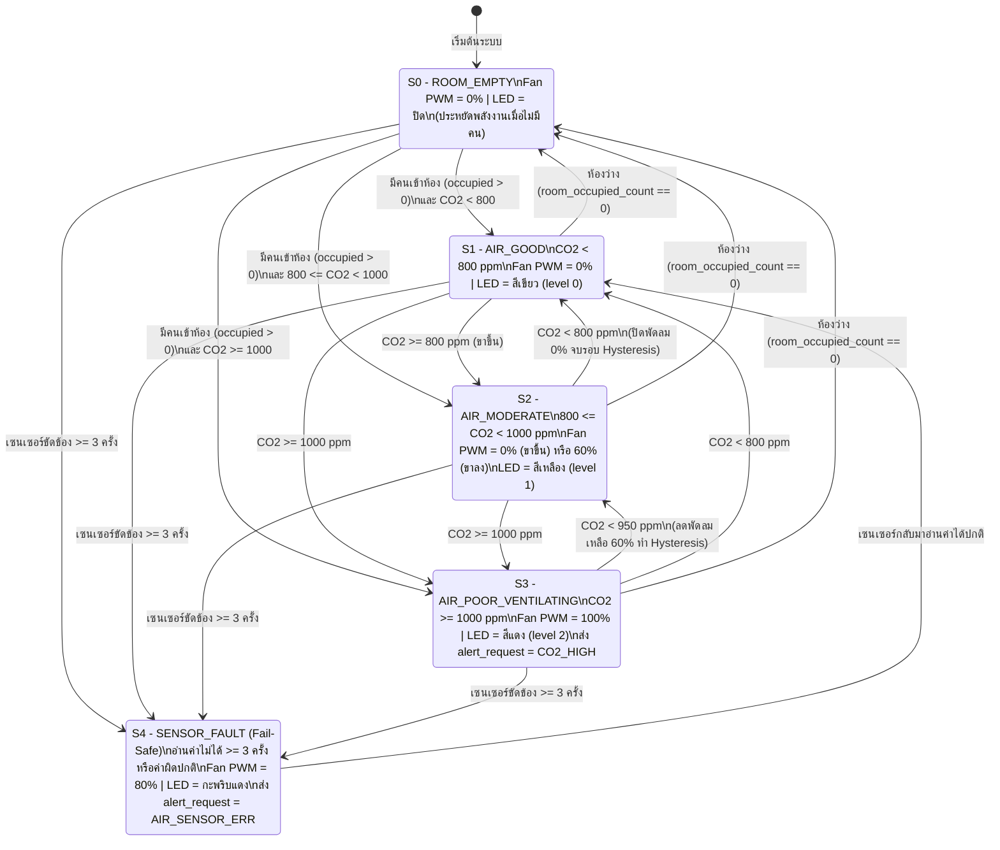

# C2: การออกแบบซอฟต์แวร์และลอจิก โมดูลตรวจวัดคุณภาพอากาศและควบคุมพัดลม (v1)

> **รหัสเอกสาร:** C2_logic_air_v1  
> **ผู้จัดทำ:** C (ซัน - ทิวากร ฉับพลัน 6701012610112) | โมดูลอากาศ + ภาพจำลอง + แผนทดสอบ  
> **ส่งให้:** A (ใช้เขียนโค้ดจริงในโหนดห้อง), D (ใช้รวมเล่มหัวข้อ 5)  
> **สถานะความสำคัญ:** 🔴 มีคนรอใช้ (อยู่ในเส้นทางวิกฤต - A รอนำไปเขียนโค้ด)  
> **เนื้อหาสำหรับรายงาน:** หัวข้อ 5 (Software Design - Flowcharts/UML, Pseudocode)

---

## 1. สถานะทั้งหมดของระบบ (Finite State Machine - FSM States)

ระบบควบคุมคุณภาพอากาศบนโหนดห้อง แบ่งการทำงานออกเป็น **5 สถานะหลัก** ดังนี้:

| รหัสสถานะ | ชื่อสถานะ | ความหมายและการทำงานหลัก |
|---|---|---|
| **S0** | `ROOM_EMPTY` (โหมดประหยัดพลังงานเมื่อห้องว่าง) | ไม่มีคนนั่งทำงานในห้องเลย (`room_occupied_count == 0`) ระบบจะปิดพัดลมดูดอากาศ (`PWM = 0%`) หรือลดการทำงานเพื่อประหยัดพลังงาน และหรี่ไฟสถานะ แต่ยังอ่านค่าอากาศทุก 5 วินาทีเพื่อติดตามสภาพห้อง |
| **S1** | `AIR_GOOD` (อากาศดี - ปกติ) | มีคนในห้อง (`room_occupied_count > 0`) และระดับ $\text{CO}_2 < 800\ \text{ppm}$ พัดลมดูดอากาศปิด (`PWM = 0%`) ไฟสถานะแสดง **สีเขียว** (`air_level = 0`) |
| **S2** | `AIR_MODERATE` (อากาศเริ่มสะสม - เฝ้าระวัง) | มีคนในห้อง และระดับ $800\ \text{ppm} \le \text{CO}_2 < 1000\ \text{ppm}$ ไฟสถานะเปลี่ยนเป็น **สีเหลือง** (`air_level = 1`)<br>- หากมาจากสถานะ `AIR_GOOD`: พัดลมยังคงปิด (`PWM = 0%`) เพื่อรอดูแนวโน้ม<br>- หากมาจากสถานะ `AIR_POOR` (กำลังระบายอากาศลงมา): พัดลมจะยังหมุนต่อที่ความเร็วปานกลาง (`PWM = 60%`) จนกว่าค่า $\text{CO}_2$ จะลดต่ำกว่า $800\ \text{ppm}$ (หลักการ **Hysteresis**) |
| **S3** | `AIR_POOR_VENTILATING` (อากาศแย่ - เร่งระบายอากาศ) | มีคนในห้อง และระดับ $\text{CO}_2 \ge 1000\ \text{ppm}$ ระบบสั่งเปิดพัดลมดูดอากาศเต็มกำลัง (`PWM = 100%`) ไฟสถานะแสดง **สีแดง** (`air_level = 2`) และส่ง `alert_request` ข้าม Wi-Fi ไปแจ้งเตือนบนจอโต๊ะทำงาน |
| **S4** | `SENSOR_FAULT` (โหมดนิรภัยเมื่อเซนเซอร์ขัดข้อง) | อ่านค่าจากเซนเซอร์ SCD41 ไม่ได้ติดต่อกันเกิน 3 ครั้ง (15 วินาที) หรือค่าที่อ่านได้หลุดช่วงความเป็นจริง ($\text{CO}_2 < 300$ หรือ $> 10000\ \text{ppm}$) ระบบเข้าสู่ **Fail-Safe Mode** โดยบังคับเปิดพัดลมที่ `PWM = 80%` เพื่อความปลอดภัยของผู้ใช้ ไฟสถานะ **กะพริบสีแดง** และส่ง `alert_request` แจ้งว่าเซนเซอร์อากาศขัดข้อง (อ้างอิง บท 6 หัวข้อ 6.2.3 หน้า 22–26) |

---

## 2. ตารางเปลี่ยนสถานะ (State Transition Table)

| จากสถานะ | ไปสถานะ | เงื่อนไข (Guard Condition) | สิ่งที่ระบบทำ (Action) |
|---|---|---|---|
| ทุกสถานะ (ยกเว้น `S4`) | `S4: SENSOR_FAULT` | `sensor_error_count >= 3` หรือค่าไม่อยู่ในช่วง $300 \le \text{CO}_2 \le 10000$ | สั่ง `Fan_PWM = 80%`, ไฟ RGB กะพริบสีแดง, ส่ง `alert_request = "AIR_SENSOR_ERR"` |
| `S4: SENSOR_FAULT` | `S1` หรือ `S0` | อ่านค่าเซนเซอร์สำเร็จติดต่อกัน 2 ครั้ง (`sensor_error_count == 0`) | ยกเลิกคำเตือนเซนเซอร์เสีย และกลับไปประเมินสถานะตามค่าจริง |
| `S1`, `S2`, `S3` | `S0: ROOM_EMPTY` | `room_occupied_count == 0` (ไม่มีคนอยู่ในห้องเลย) | ปิดพัดลม `Fan_PWM = 0%`, ปิดไฟสถานะ RGB (ประหยัดไฟ) |
| `S0: ROOM_EMPTY` | `S1: AIR_GOOD` | `room_occupied_count > 0` และ $\text{CO}_2 < 800\ \text{ppm}$ | `Fan_PWM = 0%`, ไฟ RGB = สีเขียว, `air_level = 0` |
| `S0: ROOM_EMPTY` | `S2: AIR_MODERATE` | `room_occupied_count > 0` และ $800 \le \text{CO}_2 < 1000\ \text{ppm}$ | `Fan_PWM = 0%`, ไฟ RGB = สีเหลือง, `air_level = 1` |
| `S0: ROOM_EMPTY` | `S3: AIR_POOR` | `room_occupied_count > 0` และ $\text{CO}_2 \ge 1000\ \text{ppm}$ | `Fan_PWM = 100%`, ไฟ RGB = สีแดง, `air_level = 2`, ส่ง `alert_request` |
| `S1: AIR_GOOD` | `S2: AIR_MODERATE` | $\text{CO}_2 \ge 800\ \text{ppm}$ และ $\text{CO}_2 < 1000\ \text{ppm}$ | คงค่า `Fan_PWM = 0%`, เปลี่ยนไฟ RGB = สีเหลือง, `air_level = 1` |
| `S1: AIR_GOOD` | `S3: AIR_POOR` | $\text{CO}_2 \ge 1000\ \text{ppm}$ (เพิ่มขึ้นอย่างรวดเร็ว) | เปิดพัดลม `Fan_PWM = 100%`, ไฟ RGB = สีแดง, `air_level = 2`, ส่ง `alert_request = "CO2_HIGH"` |
| `S2: AIR_MODERATE` | `S3: AIR_POOR` | $\text{CO}_2 \ge 1000\ \text{ppm}$ | เปิดพัดลม `Fan_PWM = 100%`, ไฟ RGB = สีแดง, `air_level = 2`, ส่ง `alert_request = "CO2_HIGH"` |
| `S2: AIR_MODERATE` | `S1: AIR_GOOD` | $\text{CO}_2 < 800\ \text{ppm}$ | ปิดพัดลม `Fan_PWM = 0%` (จุดตัด Hysteresis ล่าง), ไฟ RGB = สีเขียว, `air_level = 0` |
| `S3: AIR_POOR` | `S2: AIR_MODERATE` | $800 \le \text{CO}_2 < 950\ \text{ppm}$ (อากาศเริ่มดีขึ้นแต่ยังไม่ต่ำกว่า 800 ppm) | ลดความเร็วพัดลมลงเป็น `Fan_PWM = 60%` (ยังไม่ปิดสนิทเพื่อดึง $\text{CO}_2$ ให้พ้นช่วงเฝ้าระวัง), ไฟ RGB = สีเหลือง, `air_level = 1` |
| `S3: AIR_POOR` | `S1: AIR_GOOD` | $\text{CO}_2 < 800\ \text{ppm}$ | ปิดพัดลม `Fan_PWM = 0%`, ไฟ RGB = สีเขียว, `air_level = 0` |

> **หมายเหตุเรื่องการแจ้งเตือนอุณหภูมิ (แยกอิสระจากสถานะพัดลม):**  
> ในทุกๆ รอบการอ่านค่า (5 วินาที) หากมีคนอยู่ในห้อง (`room_occupied_count > 0`) และพบว่าอุณหภูมิห้องไม่อยู่ในช่วงเหมาะสม คือ $T < 20.0^\circ\text{C}$ หรือ $T > 25.0^\circ\text{C}$ (จากค่าที่เหมาะสมที่สุด $21-22^\circ\text{C}$ ตามงานวิจัย [5]) ระบบจะแนบสถานะแจ้งเตือนอุณหภูมิไปกับ `alert_request` เพื่อให้จอ OLED บนโต๊ะแจ้งให้ผู้ใช้ปรับเครื่องปรับอากาศ โดยระบบจะไม่ควบคุมแอร์โดยตรง

---

## 3. แผนภาพสถานะ (FSM State Diagram)

*(สามารถนำโค้ด Mermaid ด้านล่างไป Render หรือวาดตามใน draw.io เพื่อส่งออกเป็นไฟล์ PNG ไว้ใน `07_visuals/` ได้ทันที)*



---

## 4. รหัสเทียม (Pseudocode)

```text
// ============================================================================
// โมดูลควบคุมคุณภาพอากาศและพัดลมระบายอากาศ (โหนดห้อง - Room Node)
// ทำงานทุกๆ 5,000 ms (5 วินาที) ภายใต้ระบบปฏิบัติการ FreeRTOS
// ============================================================================

CONST CO2_THRESHOLD_HIGH = 1000      // ค่าเริ่มเปิดพัดลมเต็มกำลัง [อ้างอิง 2]
CONST CO2_THRESHOLD_HYST_MID = 950   // ค่าเริ่มลดความเร็วพัดลมลงมาที่ระดับกลาง
CONST CO2_THRESHOLD_LOW  = 800       // ค่าปิดพัดลม (Hysteresis band = 200 ppm)
CONST TEMP_OPTIMAL_MIN   = 20.0      // อุณหภูมิต่ำสุดที่ยอมรับได้ (เหมาะสมที่สุด 21-22°C [อ้างอิง 5])
CONST TEMP_OPTIMAL_MAX   = 25.0      // อุณหภูมิสูงสุดก่อนเตือน
CONST MAX_SENSOR_ERRORS  = 3         // จำนวนครั้งที่อ่านพลาดติดต่อกันก่อนเข้า Fail-safe

STATE current_state = S0_ROOM_EMPTY
INT sensor_error_count = 0
BOOL fan_was_active = FALSE          // ตัวแปรจำสถานะ Hysteresis ขาลง

TASK AirQuality_And_Fan_Task (ทำงานทุก 5000 ms):
    LOOP FOREVER:
        // --- ส่วนที่ 1: อ่านค่าจากเซนเซอร์ SCD41 ผ่าน I2C พร้อม Mutex Lock ---
        ACQUIRE_MUTEX(i2c_lock, timeout = 100 ms)
        IF lock_acquired THEN
            (read_ok, co2, temp, hum) = READ_SCD41_SENSOR()
            RELEASE_MUTEX(i2c_lock)
        ELSE
            read_ok = FALSE
        END IF

        // --- ส่วนที่ 2: ตรวจสอบความถูกต้องของข้อมูล (Fault Detection) ---
        IF (read_ok == FALSE) OR (co2 < 300) OR (co2 > 10000) OR (temp < -10) OR (temp > 60) THEN
            sensor_error_count = sensor_error_count + 1
        ELSE
            sensor_error_count = 0
        END IF

        // --- ส่วนที่ 3: ประมวลผลสถานะ (FSM State Evaluation & Transition) ---
        IF sensor_error_count >= MAX_SENSOR_ERRORS THEN
            current_state = S4_SENSOR_FAULT
        ELSE IF room_occupied_count == 0 THEN
            current_state = S0_ROOM_EMPTY
            fan_was_active = FALSE
        ELSE
            // กรณีมีคนอยู่ในห้องและเซนเซอร์ปกติ
            IF co2 >= CO2_THRESHOLD_HIGH THEN
                current_state = S3_AIR_POOR
                fan_was_active = TRUE
            ELSE IF co2 < CO2_THRESHOLD_LOW THEN
                current_state = S1_AIR_GOOD
                fan_was_active = FALSE
            ELSE
                // ช่วง 800 <= CO2 < 1000 ppm (Hysteresis Zone)
                IF (current_state == S3_AIR_POOR) AND (co2 >= CO2_THRESHOLD_HYST_MID) THEN
                    current_state = S3_AIR_POOR   // ยังคงเร่งพัดลม 100% จนกว่าจะลดต่ำกว่า 950 ppm
                ELSE
                    current_state = S2_AIR_MODERATE
                END IF
            END IF
        END IF

        // --- ส่วนที่ 4: สั่งการอุปกรณ์ขับเคลื่อน (Actuator & LED Output) ---
        SWITCH (current_state):
            CASE S0_ROOM_EMPTY:
                SET_FAN_PWM(0%)
                SET_RGB_LED(OFF)
                air_status.level = 0
                
            CASE S1_AIR_GOOD:
                SET_FAN_PWM(0%)
                SET_RGB_LED(GREEN)
                air_status.level = 0

            CASE S2_AIR_MODERATE:
                IF fan_was_active == TRUE THEN
                    SET_FAN_PWM(60%)     // ขาลงจาก S3: หมุนพัดลมต่อแบบเบาจนกว่าจะต่ำกว่า 800 ppm
                ELSE
                    SET_FAN_PWM(0%)      // ขาขึ้นจาก S1: ยังไม่เปิดพัดลม แต่แสดงไฟเหลืองเตือน
                END IF
                SET_RGB_LED(YELLOW)
                air_status.level = 1

            CASE S3_AIR_POOR:
                SET_FAN_PWM(100%)
                SET_RGB_LED(RED)
                air_status.level = 2
                SEND_ALERT(alert_request = "CO2_HIGH_VENTILATING")

            CASE S4_SENSOR_FAULT:
                SET_FAN_PWM(80%)         // Fail-Safe: บังคับระบายอากาศไว้ก่อนเพื่อความปลอดภัย
                SET_RGB_LED(BLINK_RED)
                air_status.level = 2
                SEND_ALERT(alert_request = "AIR_SENSOR_ERROR")
        END SWITCH

        // --- ส่วนที่ 5: ตรวจสอบอุณหภูมิห้อง (เตือนอย่างเดียว ไม่คุมแอร์) ---
        IF (current_state != S4_SENSOR_FAULT) AND (room_occupied_count > 0) THEN
            IF (temp > TEMP_OPTIMAL_MAX) THEN
                SEND_ALERT(alert_request = "TEMP_TOO_HIGH")
            ELSE IF (temp < TEMP_OPTIMAL_MIN) THEN
                SEND_ALERT(alert_request = "TEMP_TOO_LOW")
            END IF
        END IF

        // --- ส่วนที่ 6: อัปเดตตารางข้อมูลกลางเพื่อส่งข้าม Wi-Fi ---
        air_status.co2_ppm = co2
        air_status.temperature_c = temp
        air_status.humidity_rh = hum

        WAIT_UNTIL_NEXT_PERIOD(5000 ms)
    END LOOP
```

---

## 5. ค่าที่ใช้และที่มา (Thresholds & Justifications)

| พารามิเตอร์ | ค่าที่กำหนด | เหตุผลและแหล่งอ้างอิง |
|---|---|---|
| **เกณฑ์เปิดพัดลมดูดอากาศ ($\text{CO}_2$ สูง)** | $\ge 1000\ \text{ppm}$ | อ้างอิงงานวิจัยของ Satish et al. [2] พบว่าที่ความเข้มข้น $\text{CO}_2$ ระดับ $1000\ \text{ppm}$ ประสิทธิภาพการตัดสินใจของมนุษย์ลดลงอย่างมีนัยสำคัญใน 6 จาก 9 ด้าน และตรงกับเกณฑ์แนะนำของมาตรฐาน ASHRAE สำหรับห้องทำงาน |
| **เกณฑ์ปิดพัดลม ($\text{CO}_2$ ปกติ - Hysteresis)** | $< 800\ \text{ppm}$ | กำหนดช่วงต่าง (Hysteresis band) กว้าง $200\ \text{ppm}$ ($1000 \rightarrow 800\ \text{ppm}$) เพื่อป้องกันปรากฏการณ์ **Chattering / Rapid Cycling** คือการที่พัดลมเปิด-ปิดสลับกันถี่ๆ เมื่อค่า $\text{CO}_2$ แกว่งอยู่บริเวณ $999 - 1001\ \text{ppm}$ ซึ่งจะทำให้มอเตอร์พัดลมสึกหรอและเกิดเสียงรบกวนสมาธิผู้ใช้ นอกจากนี้ที่ระดับ $< 800\ \text{ppm}$ ยังสอดคล้องกับงานวิจัยของ Allen et al. [1] ที่ระบุว่าสมองทำงานได้เต็มประสิทธิภาพ |
| **เกณฑ์อุณหภูมิที่เหมาะสม** | $21 - 22^\circ\text{C}$ (เตือนเมื่อ $< 20^\circ\text{C}$ หรือ $> 25^\circ\text{C}$) | อ้างอิงงานวิจัยของ Seppänen et al. [5] ที่พบว่าประสิทธิภาพการทำงานในออฟฟิศสูงสุดอยู่ที่ช่วง $21 - 22^\circ\text{C}$ และจะเริ่มลดลงอย่างชัดเจนเมื่ออุณหภูมิสูงเกิน $25^\circ\text{C}$ |
| **คาบสัญญาณ PWM ของพัดลม** | $20\ \text{ms}$ ($50\ \text{Hz}$) | อ้างอิงสไลด์ **บทที่ 13 หน้า 95** ที่ระบุว่าคาบสัญญาณ PWM ที่เหมาะสมสำหรับการควบคุมความเร็วมอเตอร์กระแสตรง (DC Motor) อยู่ในช่วง $5 - 20\ \text{ms}$ |
| **ความถี่ในการอ่านค่าและควบคุม** | ทุก $5\ \text{วินาที}$ ($5000\ \text{ms}$) | ก๊าซ $\text{CO}_2$ และอุณหภูมิในห้องมีการเปลี่ยนแปลงอย่างช้าๆ (Slow physical dynamics) และสอดคล้องกับคาบการวัดแบบ Periodic measurement ของเซนเซอร์ SCD41 (5 วินาทีต่อครั้ง) ช่วยลดการใช้พลังงานและไม่แย่งเวลา CPU จากงานที่ต้องการ Real-time สูง |

---

## 6. ข้อมูลรับเข้าและส่งออก (Interface ตามตารางข้อมูลกลาง A1)

| ทิศทาง | ชื่อข้อมูลในตารางกลาง | ชนิดข้อมูล | รายละเอียดการใช้งานในโมดูล C |
|---|---|---|---|
| **รับเข้า (Input)** | `room_occupied_count` | ตัวเลขจำนวนเต็ม (`int`) | รับจากโหนดห้อง (ที่ A รวบรวมจากทุกโต๊ะ) ทุก 5 วินาที ถ้าเท่ากับ `0` จะเข้าสู่สถานะ `S0_ROOM_EMPTY` เพื่อปิดพัดลมประหยัดไฟ |
| **รับเข้า/ใช้ร่วม** | `i2c_lock` | `Mutex` | ใช้ล็อกบัส I²C ก่อนอ่านค่าจาก SCD41 ทุกครั้งเพื่อป้องกันข้อมูลชนกัน |
| **ส่งออก (Output)** | `air_status` | ชุดข้อมูล (`struct`: `co2`, `temp`, `hum`, `level`) | อัปเดตทุก 5 วินาที เพื่อให้ A ส่งข้าม Wi-Fi ไปแสดงผลบนจอ OLED ของโหนดโต๊ะ (โมดูล B) |
| **ส่งออก (Output)** | `alert_request` | ข้อความ/รหัสเตือน (`enum/string`) | ส่งคำขอเตือนเมื่อเกิดเหตุการณ์สำคัญ ได้แก่ `"CO2_HIGH"`, `"TEMP_TOO_HIGH"`, `"TEMP_TOO_LOW"`, และ `"AIR_SENSOR_ERROR"` |

---

## 7. การรับมือกรณีผิดพลาด (Fault Handling & Fail-Safe Design)

ออกแบบตามหลักการ **ตรวจจับ $\rightarrow$ ตอบสนอง $\rightarrow$ แจ้งเตือน** ในสไลด์ **บทที่ 6 หัวข้อ 6.2.3 หน้า 22–26**:
1. **การตรวจจับ (Fault Detection):**
   - ตรวจสอบสถานะการสื่อสาร I²C (ACK/NACK timeout และ CRC checksum ของ SCD41)
   - ตรวจสอบความสมเหตุสมผลของข้อมูล (Sanity Check / Range Check): หากค่า $\text{CO}_2 < 300\ \text{ppm}$ (ต่ำกว่าอากาศธรรมชาติบนโลกที่เป็นไปไม่ได้) หรือ $> 10,000\ \text{ppm}$ หรืออ่านค่าไม่สำเร็จติดต่อกันครบ **3 ครั้ง (15 วินาที)** เพื่อกรองสัญญาณรบกวนชั่วคราว (Transient fault)
2. **การตอบสนองอย่างปลอดภัย (Fail-Safe Response):**
   - แทนที่จะสั่งปิดพัดลมซึ่งอาจทำให้ก๊าซ $\text{CO}_2$ สะสมในห้องปิดจนเป็นอันตรายต่อผู้ใช้งานโดยไม่มีใครรู้ ระบบจะเข้าสู่โหมด **Fail-Safe (Safe State)** โดยสั่งเปิดพัดลมดูดอากาศที่ความเร็ว **80%** อัตโนมัติ เพื่อรับประกันว่าห้องยังมีการระบายอากาศอย่างต่อเนื่อง
3. **การแจ้งเตือนและการกู้คืน (Notification & Recovery):**
   - สั่งไฟสถานะ RGB บนโหนดห้องให้ **กะพริบสีแดง** และส่ง `alert_request = "AIR_SENSOR_ERROR"` ไปแสดงข้อความแจ้งเตือนบนหน้าจอ OLED ที่โต๊ะทำงาน
   - ระบบยังคงพยายามส่งคำสั่งอ่านค่าเซนเซอร์ใหม่ทุก 5 วินาที (Self-recovery) หากเซนเซอร์กลับมาส่งค่าปกติติดต่อกัน 2 ครั้ง ระบบจะยกเลิกโหมด Fail-Safe และกลับเข้าสู่สถานะทำงานปกติโดยไม่ต้องเปิด-ปิดเครื่องใหม่
