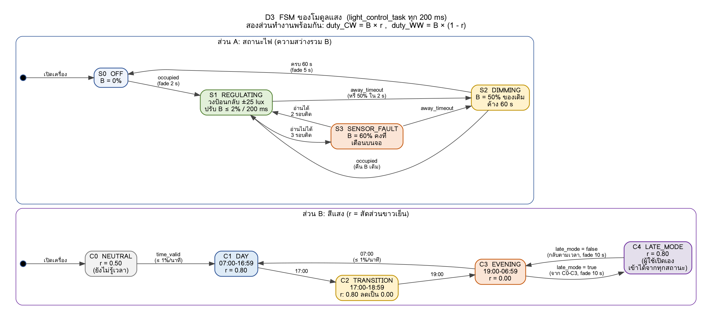

# เนื้อหาเล่ม: หัวข้อ 5.1 และ 5.2 ส่วนโมดูลแสง (D)

> ข้อความชุดนี้ตรงกับเล่มร่างของ D ทุกตัวอักษร (อัปเดต 2026-10-14 ตาม A1 v1.0 และ A2) เขียนตามกติกาเล่ม: ไม่อ้างบท/หน้าสไลด์ ไม่ใช้ขีดยาวหรือลูกศร
> เลขอ้างอิง [x] และเลขตาราง/ภาพเป็นเลขในเล่มร่าง อาจเปลี่ยนตอนรวมเล่ม
> รายละเอียดเต็มและเหตุผลของตัวเลขทุกตัวอยู่ใน `04_logic/D3_logic_light.md`

---

### 5.1.3 แผนภาพสถานะของโมดูลแสง

โมดูลแสงทำงานเป็นงานย่อย light_control_task ทุก 200 ms และแบ่ง logic เป็น 2 ส่วนที่ทำงานพร้อมกัน ตามแนวคิด AND super-state ของ statechart ที่ให้หลายกลุ่มสถานะทำงานคู่ขนานกันได้ ส่วนแรกตัดสินว่าไฟควรเปิด หรี่ หรือปิด และคุมความสว่างรวม (B) ส่วนที่สองตัดสินสัดส่วนแสงขาวเย็น (r) ตามช่วงเวลาของวัน จากนั้นนำสองค่ามารวมกันเป็นค่า duty ของ PWM ทั้งสองช่อง คือช่องขาวเย็นเท่ากับ B × r และช่องขาวอุ่นเท่ากับ B × (1 - r) การแยกแบบนี้ทำให้การเปลี่ยนสีไม่กระทบความสว่าง เพราะวงควบคุมจะปรับ B ให้แสงบนโต๊ะกลับมาที่ค่าเป้าหมายเองเสมอ



**ภาพที่ 5.3 แผนภาพสถานะของโมดูลแสง (บน: สถานะไฟ ล่าง: สีแสง)**

**ตารางที่ 5.3 สถานะไฟของโมดูลแสง**

| สถานะ | ความหมาย | การทำงาน |
|---|---|---|
| S0 OFF | ไม่มีคน | ปิดไฟ |
| S1 REGULATING | มีคนนั่ง เซนเซอร์ปกติ | อ่านแสงทุก 200 ms ถ้าต่างจากเป้าหมายเกิน 25 lux ให้ปรับ B ทีละไม่เกิน 2% |
| S2 DIMMING | ไม่มีคนครบ 5 นาที | หรี่เหลือ 50% ค้าง 60 วินาที แล้วค่อยๆ ปิด ถ้าคนกลับมาก่อน ไฟกลับไปสว่างเท่าเดิม |
| S3 SENSOR_FAULT | อ่านเซนเซอร์แสงไม่ได้ 3 รอบติดกัน | ค้างไฟที่ 60% และแจ้งเตือนบนจอ จนกว่าจะอ่านได้ปกติ 2 รอบติดกัน |

**ตารางที่ 5.4 สถานะสีแสงของโมดูลแสง**

| สถานะ | เวลา / เงื่อนไข | สัดส่วนแสงขาวเย็น (r) |
|---|---|---|
| C0 NEUTRAL | ยังไม่ได้เวลาจากเครือข่าย | 0.50 |
| C1 DAY | 07:00-16:59 | 0.80 |
| C2 TRANSITION | 17:00-18:59 | ลดลงจาก 0.80 เป็น 0.00 ภายใน 120 นาที |
| C3 EVENING | 19:00-06:59 | 0.00 |
| C4 LATE_MODE | ผู้ใช้เปิดโหมดทำงานดึก | 0.80 |

ทุกการเปลี่ยนแปลงของแสงเป็นแบบค่อยเป็นค่อยไป การเปลี่ยนสีอัตโนมัติไม่เกิน 1% ต่อนาที การเปิดไฟใช้เวลา 2 วินาที การปิดไฟใช้เวลา 5 วินาที และการเปลี่ยนตามคำสั่งผู้ใช้ใช้เวลา 10 วินาที โดยใช้ฟังก์ชัน fade ของวงจร PWM ในตัว ESP32 ซึ่งไล่ค่า duty เองโดยไม่ใช้เวลาประมวลผลของ CPU [16]

### 5.2.3 Pseudocode ของโมดูลแสง

```text
TASK light_control_task (period = 200 ms)
  LOOP
    snap = read_snapshot(occupied, away_timeout, time_of_day,
                         time_valid, user_lux_target, late_mode)
    IF take(i2c_lock, 50 ms) THEN
        ok = bh1750_read_lux(lux)
        give(i2c_lock)
    ELSE
        ok = FALSE
    END IF
    update_error_counters(ok)
    target = clamp(snap.user_lux_target, 500, 1000)   // ไม่มีค่าให้ใช้ 500

    SWITCH light_state
      CASE S0_OFF:
        IF snap.occupied THEN fade_on(2 s); light_state = S1_REGULATING
      CASE S1_REGULATING:
        IF snap.away_timeout THEN enter_dimming()
        ELSE IF err_count >= 3 THEN
            set_B(60%); send_alert(SENSOR_FAULT, SHOW)
            light_state = S3_SENSOR_FAULT
        ELSE IF ok AND abs(target - lux) > 25 THEN
            B = B + clamp(0.02 * (target - lux), -2, 2)
        END IF
      CASE S2_DIMMING:
        IF snap.occupied THEN restore_B(2 s); light_state = S1_REGULATING
        ELSE IF dim_time >= 60 s THEN fade_off(5 s); light_state = S0_OFF
      CASE S3_SENSOR_FAULT:
        IF snap.away_timeout THEN enter_dimming()
        ELSE IF ok_count >= 2 THEN
            send_alert(SENSOR_FAULT, CLEAR); light_state = S1_REGULATING
        END IF
    END SWITCH

    IF snap.late_mode THEN r_target = 0.80
    ELSE IF snap.time_valid THEN r_target = schedule(snap.time_of_day)
    ELSE r_target = 0.50
    r = move_toward(r, r_target)     // อัตโนมัติไม่เกิน 1% ต่อนาที

    ledc_fade(CH_CW, B * r)
    ledc_fade(CH_WW, B * (1 - r))
    wait_until_next_period()
  END LOOP
```

เมื่อไม่มีคนครบ 5 นาที โมดูลตรวจคนจะคืนค่าที่ผู้ใช้ปรับเองทั้งหมด (ความสว่างเป้าหมายและโหมดทำงานดึก) กลับเป็นค่าเริ่มต้น เพื่อให้ผู้ใช้คนถัดไปเริ่มจากค่ามาตรฐานเสมอ โมดูลแสงอ่านค่าเหล่านี้อย่างเดียวและไม่เขียนกลับ ข้อมูลแต่ละตัวจึงมีเจ้าของเพียงโมดูลเดียว ส่วนค่าความสว่างที่อยู่นอกช่วง 500-1,000 lux โมดูลแสงจะปัดเข้าช่วงอีกชั้นหนึ่ง เพื่อป้องกันความผิดพลาดจากการป้อนค่า
